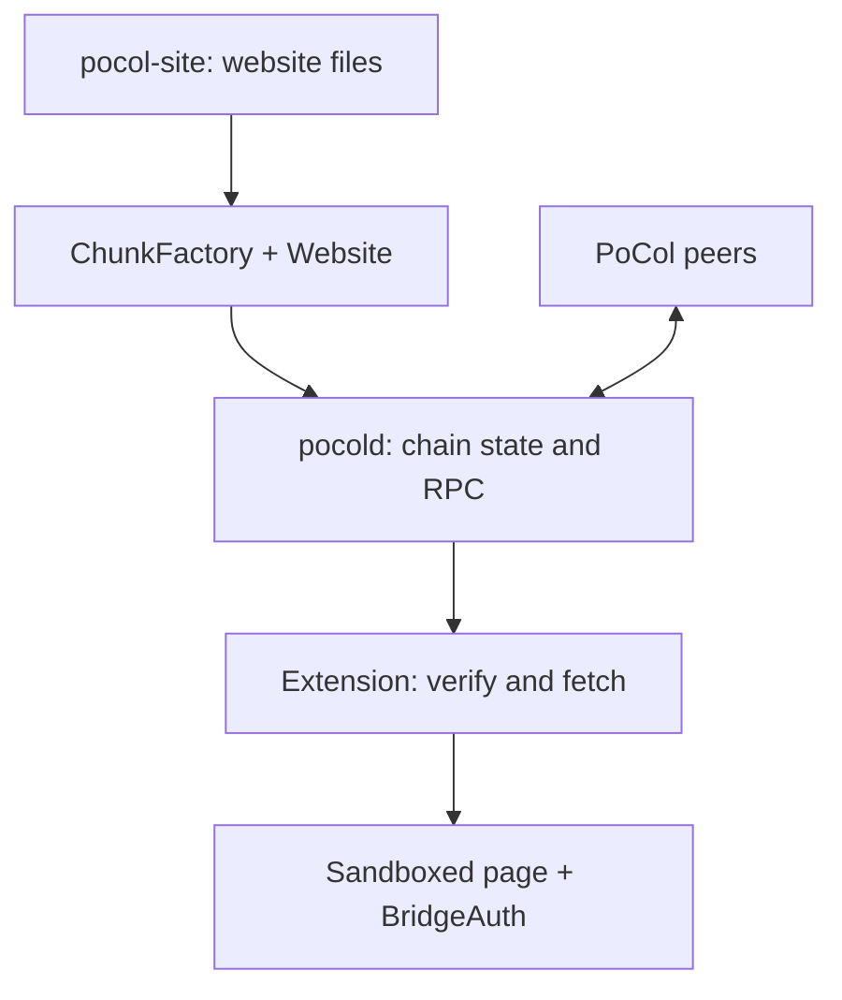

# PoCol — Proof-of-Collaboration

PoCol is a coordinated proof-of-work consensus protocol. It retains the
hash-target puzzle and cumulative-work chain selection; this does not automatically transfer PoW's security guarantees to PoCol. What it changes is how the mining work is organized.
Instead of every miner hashing its own competing candidate headers, all miners in a round work on **one canonical block
template**, and a deterministic seed gives each registered miner a **disjoint slice of the nonce space**. Under the common-template and honest-assignment assumptions, honest miners
do not hash the same candidate-header input in that round, and the reward is shared among the winner and the
miners whose work is evidenced by _shares_.

This repository holds the specification and an experimental implementation:

- `pocold`, a Rust node with an EVM (revm, Cancun rules), P2P networking, mining, persistence and JSON-RPC;
- an execution layer with system contracts;
- on-chain website storage;
- a Chrome MV3 extension that verifies and displays on-chain sites.

> **Status: experimental.** The code runs local development networks (simnet) only. It is not production-ready, has not
> had an independent external security audit, and must not be used with real funds. See
> [Current status and limits](#current-status-and-limits).

---

## Contents

1. [Origin of the idea](#origin-of-the-idea)
2. [How PoCol works](#how-pocol-works)
3. [How the project was developed](#how-the-project-was-developed)
4. [Repository and code layout](#repository-and-code-layout)
5. [Requirements](#requirements)
6. [Quick start: a local devnet](#quick-start-a-local-devnet)
7. [Publishing a site and viewing it in Chrome](#publishing-a-site-and-viewing-it-in-chrome)
8. [JSON-RPC](#json-rpc)
9. [Tests](#tests)
10. [Contributing](#contributing)
11. [Current status and limits](#current-status-and-limits)
12. [Troubleshooting](#troubleshooting)
13. [Further reading](#further-reading)
14. [License](#license)

---

## Origin of the idea

PoCol was conceived by **Raed S. Rasheed**.

The original design is described in [PhD-thesis-Raed-Rasheed-120211566-61.pdf](PhD-thesis-Raed-Rasheed-120211566-61.pdf).
The design was evaluated in simulation, using BlockSim extended with energy modelling, not on a distributed network:

- **Setup:** 20 logical miners (16 active, 4 reserve) and a nonce domain of 1,600 values, 100 per active miner.
- **Best result:** the best throughput-oriented policy retained **90.39%** of the no-floor PoCol control's accepted-block output, with a **55.05%** calculated energy reduction against the within-run power-null reference. These are distinct baselines, not a blanket energy reduction against PoW or a benchmark of this Rust implementation.
- **Against PoW:** in a matched comparison PoCol also used less energy, but produced fewer accepted blocks and had
  much longer rounds. The thesis reports this as an energy versus service-level trade-off under the configurations
  evaluated.
- **Stated limits:** the thesis lists open participation, fairness, incentive compatibility, Sybil resistance and
  PoW-equivalent security as **design objectives, not experimentally established guarantees**.

What the implementation takes from the thesis, and what it adds (the EVM layer, site storage, the browser extension,
network identity, resource policy), is listed in [development/m1/reference/scope.md](development/m1/reference/scope.md).

## How PoCol works

This is an outline. The normative rules are in [development/m1/reference/](development/m1/reference/): `consensus.md`,
`execution.md`, `network.md`, `storage.md`, `browser.md`, `governance.md`, `incentives.md` and `validation.md`.

### Network identity

- A network is defined by a `GenesisSpec`: a strict RLP encoding of the spec version, chainId, consensus parameters
  (`CP`), the initial allocation root, the initial miner list `M_0` and the system-contract code hash.
- `genesisHash = keccak256(GenesisSpec)`. Nodes and the extension check the network identity before accepting its data.
- Before boot, **ParamGate** evaluates rules R1–R26 over the consensus and local parameters. A profile that violates a
  rule is refused, and the refusal lists the rules it violates.

### A mining round

1. **Template.** The proposer of attempt 0 signs the block template: transactions, timestamp and target. If the
   proposer is late, a deterministic, unsigned **fallback block** is built after `Δ_fb_wait`.
2. **Seed and assignment.** The seed is derived from the parent block's seal. It assigns each active miner a disjoint
   nonce range (`pocol_getAssignment`).
3. **Proof of work.** The PoW input is `TemplateID ‖ nonce`. Meeting the target is necessary but not sufficient: range ownership, timing, signatures, the body and execution roots must also pass the applicable `H-full` checks.
4. **Shares.** A nonce that meets the easier share target `T_share = min(2^256 - 1, target · m)` is a share. The winner includes the
   share list in the block header.
5. **Difficulty.** ASERT, with an absolute anchor and a fixed width, steers the block time towards `T_blk`.

### Fork choice

- The chain with the **most cumulative work** wins. Ties are broken lexicographically along the branch path (D133).
- Reorganizations are bounded by `R_keep`; a deeper fork is refused.

### Rewards and settlement

- `R_tot = subsidy + fees`. The winner and the shares of a block are recorded in its child block (`ParentResult`).
- Settlement is deferred and runs through system contracts (Registry, Escrow, PAY), with exact rounding and
  classified burns.
- The design specifies a registration bond (`B_reg`) and activity eligibility. The current devnet builder sets `R_max=0`, so new registration/reactivation is disabled in that profile; the initial miners come from genesis.

### Execution (EVM)

- User transactions run on revm 19.7 with Cancun rules. Consensus and execution are kept apart:
  `apply(S_parent, ctx, body, parentHeader) → (S, receipts, roots, …)`.
- The network has cumulative caps on accounts, storage slots, code and transaction bytes, and a final closing
  height `H_END`.

### Site storage and the browser

- **Storage.** A website is split into chunks deployed as contracts at CREATE2 addresses through `ChunkFactory`, with a
  manifest that carries every file's hash. Each site has versions and a `current()` pointer.
- **Verification.** The Chrome extension fetches a site and checks every chunk's address, the manifest hash and every
  file hash. It then renders the site in a sandboxed frame with no network access (CSP, per-tab DNR rules,
  RtcLockdown), and every request from the site goes through BridgeAuth.
- **Light client (RP).** Checks network identity and a window of at most 13 headers. It does not reexecute the full chain or prove the complete EVM state. **LN** relies on a trusted local node. Read the trust banner outside the site frame and the [extension coverage table](development/lp9/LP9-EXTENSION.md).
- **Wallet.** Devnet only. Every signature needs a confirmation that shows the exact bytes.

## How the project was developed

After the thesis, the implementation was built under the direction and approvals of the author, with AI coding agents
in separate roles:

- **Claude** (Anthropic) authors changes: specification, code, tests and evidence.
- **Codex** (OpenAI) reviews them independently, runs the checks, and has carried out some repair rounds.
- **The owner** takes every consensus and normative decision. Nothing counts as decided until the owner approves it
  explicitly. Open decisions are recorded in `development/audit-2026-10-22/proposals/`.

The working rules are in [development/README.md](development/README.md):

- every finding is tied to a requirement and to evidence;
- no item is closed by elapsed time or by agreement alone;
- a passing rerun does not explain an earlier failure.

Stages, in order:

| Stage                                  | What it delivered                                                                                                                                 | Where                                                                                      |
| -------------------------------------- | ------------------------------------------------------------------------------------------------------------------------------------------------- | ------------------------------------------------------------------------------------------ |
| **M1**                                 | The specification: from the Arabic baseline to English drafts 0.1–0.33, with byte-level vectors and independent reviews                           | `development/m1/`                                                                          |
| **LP1–LP2**                            | A first Rust node (RLP, GenesisSpec, ParamGate, headers, ASERT, assignment) and a candidate-header journal                                        | `prototypes/lp1-node/`, `development/lp1`, `lp2`                                           |
| **LP3**                                | A TypeScript reference model of the arithmetic, timing, membership and assignment, cross-checked against Rust                                     | `prototypes/lp3-model/`, `development/lp3`                                                 |
| **LP4**                                | The execution layer: revm, system contracts, mempool, PAY, settlement, caps and resource bounds                                                   | `prototypes/lp4-execution/`, `development/lp4`                                             |
| **LP5–LP7**                            | The `pocold` node: block production and mining, fork choice, multi-node sync, P2P and RPC                                                         | `prototypes/pocold/`                                                                       |
| **LP8**                                | Site contracts, chunk storage, publishing and verified fetching                                                                                   | `prototypes/lp4-execution/contracts/`, `prototypes/pocold/src/site.rs`, `development/lp8/` |
| **LP9**                                | The Chrome MV3 extension                                                                                                                          | `prototypes/pocol-extension/`, `development/lp9`                                           |
| **LP10**                               | An integrated devnet: site publishing, reorganization, restart and the browser                                                                    | `prototypes/lp10/`, `development/lp10`                                                     |
| **Audit of 2026-10-22 and its rounds** | Repairs A01–A14, the A13 memory bound, the on-disk state store (redb), checkpoints, RpcGuard, I/O-fault handling, Windows and Chrome verification | `development/audit-2026-10-22/`                                                            |

Stage reports: [development/reports/](development/reports/) and [development/STATUS-EN.md](development/STATUS-EN.md),
now available in English. The status of every audit finding: `development/audit-2026-10-22/FINDING-STATUS.json`.

## Repository and code layout

This is a multi-package repository, not a single root Cargo/npm workspace. Some LP1 source files are imported directly by
LP4 and `pocold`, so changing a shared primitive can affect more than one package.



```
.
├── PhD-thesis-Raed-Rasheed-120211566-61.pdf   the thesis (origin of the idea)
├── development/                               specification, tracking, evidence, decisions
│   ├── m1/reference/                          reference specification (English): consensus, execution, network, storage, browser, …
│   ├── m1/M1-SPEC.md, m1-draft-*/            English specification drafts and their vectors
│   ├── VA-SPEC.md                             validation specification
│   ├── lp1 … lp10/                            evidence for each stage
│   ├── audit-2026-10-22/                      the audit, its repair rounds, evidence and the open-decision table
│   ├── reports/, STATUS-EN.md                 status summaries (English)
│   └── *-APPROVAL.md, OWNER-STANDING-AUTHORIZATION.md   owner approvals
├── prototypes/
│   ├── pocold/                                the node (Rust 1.99.1)
│   ├── lp4-execution/                         execution layer and system contracts (Rust 1.99.1 + Solidity)
│   ├── pocol-extension/                       Chrome MV3 extension (JavaScript)
│   ├── lp1-node/                              the first node: encoding and verification (Rust 1.58)
│   ├── lp3-model/                             reference model (TypeScript)
│   └── lp10/run_lp10.py                       runs every suite
└── .github/workflows/                         Windows, Chrome, LP3 and LP4 checks
```

### `prototypes/pocold` — the node

| File                                   | Responsibility                                                                    |
| -------------------------------------- | --------------------------------------------------------------------------------- |
| `src/main.rs`                          | Command line: `init-devnet`, `run`, `status`                                      |
| `src/node.rs`                          | Event loop: import, validation, mempool, templates, recovery at open              |
| `src/chain.rs`                         | Block tree, work-based fork choice, reorganization, retention, side blocks        |
| `src/miner.rs`                         | Mining inside the assigned range, shares                                          |
| `src/net.rs`                           | P2P over TCP: handshake, sync, gossip, connection limits                          |
| `src/rpc.rs`                           | JSON-RPC server with RpcGuard (queues, deadlines, rate limits, memory bounds)     |
| `src/store.rs`                         | Block journal `blocks.journal` (append-only, torn-tail recovery)                  |
| `src/history.rs`                       | `history.redb`: receipts and the transaction index                                |
| `src/state_store.rs`                   | `state.redb`: state versions as on-disk tries (experimental `--state-store` mode) |
| `src/checkpoint.rs`                    | Sealed state checkpoints bound to the journal                                     |
| `src/statediff.rs`                     | State diffs between blocks                                                        |
| `src/resources.rs`                     | The A13 model: the computed memory bound, checked at boot                         |
| `src/site.rs`, `src/bin/pocol-site.rs` | Publishing, fetching and verifying sites                                          |
| `src/bin/pocol-sign.rs`                | Signing a devnet transaction                                                      |
| `scripts/devnet.py`                    | Create, start, inspect and stop a local network                                   |
| `tests/`                               | Consensus, network, storage, caps and budget tests; Python end-to-end tests       |

### `prototypes/lp4-execution` — execution

- **Sources:**
  - `apply.rs` and `apply/`: block application;
  - `system.rs` and `system/`: system phases;
  - `pay.rs`, `native.rs`: the PAY boundary;
  - `pool.rs`: the mempool;
  - `state_trie.rs`, `node_trie.rs`: state roots;
  - `admission.rs` and `admission/`: ParamGate;
  - `resources.rs`: resource bounds;
  - `modexp.rs`: MODEXP fast paths, checked against revm;
  - `devnet.rs`: devnet genesis builder.
- **Contracts (`contracts/`):** `RegistryPayment.sol`, `PendingEscrow.sol`, `ChunkFactory.sol` and witness contracts. The
  storage layout is in `REGISTRY-LAYOUT.md`.

### `prototypes/pocol-extension` — the Chrome extension

- `src/sw.js`: the service worker (network profiles, DNR rules, routing).
- `src/lib/`:
  - `rp.js`: header window;
  - `site.js`: site fetch and verification;
  - `bridge.js`: BridgeAuth;
  - `sitestore.js`: per-site storage;
  - `wallet.js`: the wallet.
- `src/sandbox-loader.js`, `src/viewer.js`: the sandboxed frame.
- `build.mjs`: builds `dist/`, and deliberate fault builds used as negative test controls.

## Requirements

| Tool            | Version / environment                                                                                  | Used for                                                                   |
| --------------- | ------------------------------------------------------------------------------------------------------ | -------------------------------------------------------------------------- |
| Git and Bash    | Linux or WSL2 for the commands below                                                                   | Source checkout and local launcher                                         |
| Rust via rustup | **1.99.1**, pinned in the current node/execution crates                                                | `pocold`, `lp4-execution`; native build tools and a linker are also needed |
| Rust            | **1.58.1** in the legacy verification workflow                                                         | LP1 compatibility checks                                                   |
| Python 3        | Existing verification paths use 3.11/3.12                                                              | Devnet launcher and integration tests                                      |
| Node.js and npm | **22.22.0** is used in Windows verification; use at least 22.18 for the TypeScript test commands below | Extension and reference model                                              |
| Chrome/Chromium | Extension manifest minimum: **130**                                                                    | Loading the MV3 extension                                                  |
| Playwright      | **1.62.1** in the current browser workflow                                                             | Automated browser tests only                                               |

Linux, Windows Server 2022 and real Chrome verification are recorded in the [R6 report](development/audit-2026-10-22/evidence/codex-r6/STATUS-EN.md).
The walkthrough below uses Bash; it is not a claim that every command is portable to PowerShell or tested on macOS.
On Ubuntu, `build-essential` supplies the usual native compiler/linker basics. Docker and a production server are not required.
Builds and long-running tests need disk and memory headroom; a node's resource model is not a total-machine build requirement.

## Quick start: a local devnet

### 1. Build from the repository root

Keep the same terminal for the variables used later. The commands use the default Cargo target directory.

```bash
git clone https://github.com/palcertcom/pocol.git
cd pocol
git rev-parse HEAD

rustup toolchain install 1.99.1 --profile minimal
cargo +1.99.1 build --release --locked \
  --manifest-path prototypes/pocold/Cargo.toml --bins

npm ci --ignore-scripts --prefix prototypes/pocol-extension
npm run build --prefix prototypes/pocol-extension
```

Binaries: `prototypes/pocold/target/release/{pocold,pocol-site,pocol-sign}`.
Extension: `prototypes/pocol-extension/dist/`. Edit `src/`, not generated `dist/`; the extension build replaces its output directory.

### 2. Create and start three nodes

All generated accounts and miner identities are deterministic, disposable devnet keys. Never use them to hold real funds.

```bash
POCOL_WORK=$(mktemp -d /tmp/pocol-devnet.XXXXXX)
printf 'Devnet directory: %s\n' "$POCOL_WORK"

python3 prototypes/pocold/scripts/devnet.py init "$POCOL_WORK" --miners a,b,c
python3 prototypes/pocold/scripts/devnet.py start "$POCOL_WORK" --log
python3 prototypes/pocold/scripts/devnet.py status "$POCOL_WORK"
python3 prototypes/pocold/scripts/devnet.py rpc "$POCOL_WORK" a eth_blockNumber
```

After startup, block heights should increase. Repeat `status` if the processes are still starting.

| Item                        | Default                                      |
| --------------------------- | -------------------------------------------- |
| Network                     | Local `simnet`, chainId **777900**           |
| Node RPC endpoints          | `127.0.0.1:8540`, `8541`, `8542`             |
| Peer endpoints              | `127.0.0.1:30300` through `30302`            |
| Genesis and browser profile | `$POCOL_WORK/net/`, including `profile.json` |
| Per-node data               | `$POCOL_WORK/data/<label>/`                  |
| Logs                        | `$POCOL_WORK/a.log`, `b.log`, `c.log`        |

Use the current timing defaults in [`DevnetConfig`](prototypes/lp4-execution/src/devnet.rs): **`T_blk=4`, `dFbWait=3`**.
Some historical LP10 examples use older values. Do not copy `--t-blk 2` into the current profile by itself; timing must satisfy
admission and fallback rules. The devnet builder deliberately refuses the network chainId **777001**.

Only run one network on these ports. Do not call `start` twice on a running network or expose RPC publicly.
`prototypes/pocold/target/release/pocold help` lists direct node commands and options.

### 3. Stop and resume without replacing data

```bash
python3 prototypes/pocold/scripts/devnet.py stop "$POCOL_WORK"
# After the processes exit, resume from the same directory when needed:
python3 prototypes/pocold/scripts/devnet.py start "$POCOL_WORK" --log
```

Keep the printed `POCOL_WORK` path to resume from another terminal. Do not rerun `init` to resume an existing network.
The default mode keeps whole-state snapshots in memory alongside a durable block journal. Experimental on-disk state mode
is available through `POCOLD_RUN_ARGS=--state-store`; use a fresh data directory for it and the same mode on every restart.
Do not switch an existing directory's mode or delete its journal to make an error disappear.

## Publishing a site and viewing it in Chrome

With the preceding network running, publish a small site using the genesis-funded test account `alice`:

```bash
mkdir "$POCOL_WORK/site"
printf '%s\n' '<!doctype html><html lang="en"><meta charset="utf-8"><title>PoCol</title><h1>Hello from PoCol</h1></html>' \
  > "$POCOL_WORK/site/index.html"

POCOL_CHAIN_ID=$(python3 -c \
  'import json,sys; print(json.load(open(sys.argv[1]))["chainId"])' \
  "$POCOL_WORK/net/devnet.json")

prototypes/pocold/target/release/pocol-site publish \
  --rpc 127.0.0.1:8540 --chain-id "$POCOL_CHAIN_ID" \
  --account alice --dir "$POCOL_WORK/site" \
  > "$POCOL_WORK/published.json"

POCOL_SITE=$(python3 -c \
  'import json,sys; print(json.load(open(sys.argv[1]))["site"])' \
  "$POCOL_WORK/published.json")
printf 'Site address: %s\n' "$POCOL_SITE"

prototypes/pocold/target/release/pocol-site fetch \
  --rpc 127.0.0.1:8541 --site "$POCOL_SITE" \
  --out "$POCOL_WORK/fetched"
```

Publishing may wait for several transactions to be included. Success returns the site address, version and manifest data.
The second node must have synchronized before it can fetch the site; check its height and retry the fetch if needed.
The fetch verifies chunk addresses, the manifest and every file. Its output directory must be new or empty.
To update the same site later, edit the source files and repeat **only** the publish command with `--site "$POCOL_SITE"`.

### Load the extension

1. Open `chrome://extensions`, enable Developer mode, choose **Load unpacked**, and select `prototypes/pocol-extension/dist`.
2. Open the extension options. Paste the **contents** of `$POCOL_WORK/net/profile.json`, not just its pathname, and add the profile.
3. Wait for enough headers for the RP window. In the address bar, enter the keyword `pocol`, press Space or Tab, then enter
   `devnet/<site-address>/`; alternatively open the site from the options page.
4. Read the trust banner outside the page frame. RP verification is not full-chain execution.

For WSL, the browser must be able to reach the node at `http://127.0.0.1:8540`. Keep the node and browser local; exposing RPC
on a public interface is not a setup workaround.

The extension wallet is experimental and local-devnet-only. Creating it, granting a site access and confirming a transaction
are separate actions. See [LP9](development/lp9/LP9-EXTENSION.md) for the wallet, isolation and feature-coverage details.
Do not import a key that protects real assets.

The [historical LP10 runbook](development/lp10/LP10-RUNBOOK.md) documents the broader scenario; prefer the current defaults
and root-relative commands above when its older examples differ.

## JSON-RPC

The node serves a subset of the standard `eth_*` methods:

- `eth_blockNumber`, `eth_chainId`, `eth_getBalance`, `eth_getCode`, `eth_getStorageAt`;
- `eth_call`, `eth_estimateGas`, `eth_sendRawTransaction`, `eth_getTransactionReceipt`;
- `eth_getLogs`, `eth_getBlockByNumber`, `eth_feeHistory`, and others.

It also serves `net_*`, `web3_clientVersion`, and PoCol-specific methods:

| Method                                                                                          | Purpose                                                      |
| ----------------------------------------------------------------------------------------------- | ------------------------------------------------------------ |
| `pocol_status`, `pocol_syncStatus`                                                              | Node and sync status                                         |
| `pocol_getTemplate`, `pocol_getAssignment`, `pocol_getTarget`, `pocol_submitShare`              | Template, nonce range, target, share submission (local only) |
| `pocol_getMiners`, `pocol_getMinerSet`                                                          | Miners and the active set                                    |
| `pocol_getSettlement`, `pocol_getEscrow`, `pocol_getPot`, `pocol_getBurnTotals`                 | Rewards, settlement, burns                                   |
| `pocol_getHeaders`, `pocol_getBlockRlp`, `pocol_getLogs`                                        | Headers for light clients, raw blocks, branch-bound logs     |
| `pocol_getParams`, `pocol_getCaps`, `pocol_getTiming`, `pocol_getClosing`, `pocol_getRetention` | Parameters, caps, timing, closing, retention                 |
| `pocol_getRejects`, `pocol_getRpcStats`                                                         | Diagnostics                                                  |

RPC limits (connections, sizes, deadlines) are described in `development/m1/reference/network.md` and
`development/audit-2026-10-22/RPCGUARD.md`.

## Tests

### Component tests

Run from the repository root after the build/install steps above:

```bash
cargo +1.99.1 test --release --locked --manifest-path prototypes/lp4-execution/Cargo.toml
cargo +1.99.1 test --release --locked --manifest-path prototypes/pocold/Cargo.toml
npm test --prefix prototypes/pocol-extension

npm ci --ignore-scripts --prefix prototypes/lp3-model
npm run typecheck --prefix prototypes/lp3-model
npm test --prefix prototypes/lp3-model
```

LP1 compatibility is also checked with Rust 1.58.1 by the [Windows verification script](.github/scripts/audit-r2-windows-verify.ps1).
I/O faults, process crashes and cap controls have separate suites and build features. Run them only against disposable test data:

```bash
cargo +1.99.1 test --release --locked --manifest-path prototypes/pocold/Cargo.toml \
  --features io-fault --test state_store --test consensus --test checkpoint_source --test eviction_memory
cargo +1.99.1 test --release --locked --manifest-path prototypes/pocold/Cargo.toml \
  --features crash-test --test consensus
```

Fault-enabled binaries are test instruments. Rebuild the normal `--release --locked --bins` target before using the regular
walkthrough again. Do not use extension `dist-fault-*` builds for normal browsing.

### Live network and browser tests

Stop the demonstration devnet first. These tests reuse the node ports and also use `8600–8602`; run one suite at a time.

```bash
python3 prototypes/pocold/scripts/devnet.py stop "$POCOL_WORK"
python3 prototypes/pocold/tests/e2e_devnet.py
python3 prototypes/pocold/tests/e2e_site.py
```

Browser tests need Playwright and Chromium. This setup uses the version pinned in the browser workflow and keeps the tools
outside project dependencies:

```bash
POCOL_BROWSER_TOOLS=$(mktemp -d /tmp/pocol-browser-tools.XXXXXX)
npm install --prefix "$POCOL_BROWSER_TOOLS" --ignore-scripts --no-audit --no-fund playwright@1.62.1
export PLAYWRIGHT_MODULE="$POCOL_BROWSER_TOOLS/node_modules/playwright/index.mjs"
node "$POCOL_BROWSER_TOOLS/node_modules/playwright/cli.js" install --with-deps chromium

node prototypes/pocol-extension/tests/e2e_browser.mjs
node prototypes/pocol-extension/tests/e2e_integrated.mjs
```

Installing Chromium's system dependencies may need administrator privileges. The suites launch real nodes and temporary
browser profiles, including deliberate negative controls and network canaries. Use an isolated development machine.

### Combined runner and evidence

The combined runner invokes Cargo offline. Fetch the locked dependencies before the first run, and complete the extension
build and browser setup above:

```bash
cargo +1.99.1 fetch --locked --manifest-path prototypes/lp4-execution/Cargo.toml
cargo +1.99.1 fetch --locked --manifest-path prototypes/pocold/Cargo.toml
python3 prototypes/lp10/run_lp10.py
```

- Logs go to `development/lp10/logs/`; the runner **updates** `development/lp10/LP10-EVIDENCE.json`. Preserve a previous result
  separately if you need to compare it, and inspect `git diff` before committing generated evidence.
- `--only e2e-browser` runs a subset, not the full acceptance suite. A successful subset cannot stand in for all tests.
- Long-running, explicitly ignored measurements are documented with their tests, including `tests/journal_measure.rs`.
  Inspect the individual test's scope before opting into it; an ignored test is not a pass.
- On E2E failure, the harness keeps logs and inputs under `POCOL_E2E_KEEP` or `tests/failures/`. Preserve the failure evidence.
- Check [Actions](https://github.com/palcertcom/pocol/actions) and the exact checkout SHA. The Windows workflow and real-browser
  workflow cover different surfaces; some older workflows target historical branches. Path filters mean not every docs edit
  runs application CI. Never count cancelled or unexecuted tests as passing.

## Contributing

Start from current `main` on a separate branch, record its SHA, and preserve earlier specifications and evidence.
A useful pull request explains the concrete problem, the before/after behaviour, the commands and tool versions used,
the tested commit, and any missing checks. Changes to shared LP1 sources need consideration of their LP4/node consumers.
For a first contribution, reproduce a documented bug, add a focused boundary test, or improve a command's documentation.

- **Consensus is owner-gated.** A change to a consensus rule, a `CP` parameter or a wire encoding needs an owner
  decision. Write a proposal in `development/audit-2026-10-22/proposals/` with the alternatives and their effects, and
  do not implement it before it is approved.
- **Local limits.** Resource limits are not raised without a decision. Every new data structure in the node must be
  counted in the A13 model (`src/resources.rs`). The `a13_bound_breakdown` test pins the total.
- **Test before you claim.** Add a test that fails without the fix, and record the command, the version and the
  result. Keep failures in the evidence. An ignored or cancelled test does not count as a pass.
- **Style.**
  - Code and technical specifications are in English; status summaries are in English.
  - Follow the conventions of the file you edit.
  - Dependencies are pinned to exact versions in `Cargo.lock` and `package-lock.json`.
- **CI.**
  - `audit-r2-windows-verify.yml`: Windows Server 2022;
  - `pocol-browser-verify.yml`: Chrome on Linux, in both state modes;
  - `lp3-*.yml` and `lp4-execution-controls.yml`.
- **Security.**
  - Tests are limited to local nodes, local RPC and test browser profiles.
  - Never use real funds or real keys.
  - Do not publish exploit programs.

## Current status and limits

**Shown by tests, locally and in CI:**

- a three-node devnet produces blocks and stays in sync;
- reorganization at a network heal, in both directions;
- recovery after `SIGKILL`;
- site publishing and verified fetching;
- rendering in Chrome with isolation tested by negative controls;
- resuming state from checkpoints;
- the node stops on disk failures instead of judging valid blocks invalid;
- passing runs on Linux, Windows Server 2022 and Chrome.

**Not established, or still open:**

- **The production network profile does not boot on `pocold`.**
  - There is no approved network genesis.
  - Whole-state mode does not meet the A13 memory condition.
  - Rule R21 refuses the profile.
  - Only simnet admission exists (R22).
- **The memory bound.** In store mode the computed bound is about 5.2 GiB against a 6 GiB budget (the condition is
  model × 8/7 ≤ 6 GiB). Not every worst case has been measured.
- **Decisions pending with the owner.** Many consensus and normative decisions are still open: the six consensus
  proposals, the network caps, constant identity and timing calibration among them. They are listed in
  `development/audit-2026-10-22/proposals/DECISION-TABLE-2026-10-28.md`.
- **Design objectives.** PoW-equivalent security, fairness and Sybil resistance are not proven.
- **No external audit.** No independent external human security audit has been done.

**Do not use this code for a real network or with real funds.**

## Troubleshooting

| Symptom                              | What to check                                                                                                      |
| ------------------------------------ | ------------------------------------------------------------------------------------------------------------------ |
| `pocold` binary not found            | Build `--release --bins`; tools expect the default `prototypes/pocold/target/release` path                         |
| RPC unavailable / nodes not starting | Read `a.log`, `b.log`, `c.log`; check ports and the generated profile before starting more processes               |
| ParamGate refusal / `-32018`         | Read the specific rule and actual values; do not disable the gate or replace a measurement with a constant         |
| `viewIncomplete` / `viewTargetCeil`  | Check header count and timing; keep the current devnet defaults instead of shortening `T_blk` arbitrarily          |
| Network identity mismatch            | Check `chainId`, `genesisHash`, `genesisPre` and endpoint together                                                 |
| Playwright cannot be imported        | Set `PLAYWRIGHT_MODULE` to the installed absolute `index.mjs` path and install Chromium                            |
| Existing data cannot open            | Check its original state mode and retain the journal and databases for diagnosis; do not delete them automatically |
| E2E port conflicts                   | Stop the demonstration network and run one E2E suite at a time                                                     |

## Further reading

- [Research scope and later implementation additions](development/m1/reference/scope.md).
- [Consensus](development/m1/reference/consensus.md), [execution](development/m1/reference/execution.md),
  [storage](development/m1/reference/storage.md) and [threat model](development/m1/reference/threat.md).
- [Ordered local-network plan](development/LOCAL-DEVNET-PLAN.md) and [extension coverage](development/lp9/LP9-EXTENSION.md).
- [R6 status, 29 October 2026](development/audit-2026-10-22/evidence/codex-r6/STATUS-EN.md): measured results and their limits.
- [Network boot blockers by cause](development/audit-2026-10-22/BOOT-BLOCKERS-2026-10-28.md) and
  [open decisions](development/audit-2026-10-22/proposals/DECISION-TABLE-2026-10-28.md).

Historical progress pages describe their own revisions, not every later commit. Cite the thesis for the research idea,
and the repository URL **plus the commit SHA** when discussing this implementation. Treat proposed decisions as proposals
until explicitly approved, and distinguish measured results from computed resource models.

## License

The LP1, LP4, `pocold`, TypeScript-model and extension package manifests declare **Apache-2.0**.
Third-party notices are also present, including `prototypes/lp4-execution/licenses/` and the Noble notices copied into the
extension build. There is currently **no repository-wide root `LICENSE` file**. Do not assume that a code package's license
statement also licenses the thesis and every evidence asset; check the relevant component's declaration and retain its
source notices when reusing or distributing it. This README records existing declarations, not a new license grant.

For questions about the idea or the project, open an [issue](https://github.com/palcertcom/pocol/issues).
